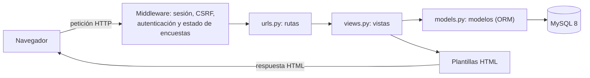
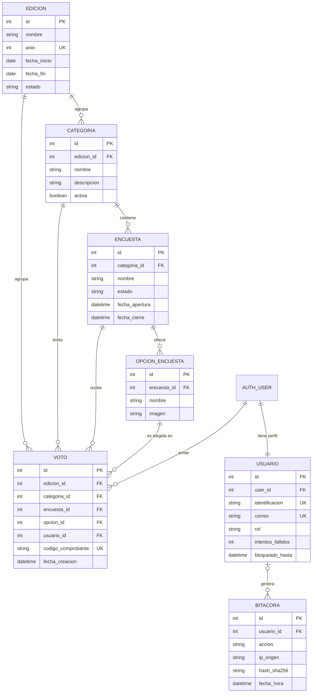

# Sistema Web de Votaciones del Festival de la Leyenda Vallenata 2027

Plataforma web para gestionar las votaciones del público del Festival de la Leyenda Vallenata. Permite que los
visitantes consulten las ediciones, categorías y encuestas del Festival, que los votantes registrados emitan un
voto por categoría y edición con un comprobante verificable, y que los administradores configuren las votaciones y
consulten sus resultados y registros. Expone además una API GET de consulta con respuesta JSON.

El proyecto se desarrolla en la asignatura **Desarrollo Web** de la **Fundación Universitaria del Área Andina**
(Ingeniería de Sistemas, modalidad virtual). Esta versión corresponde a la **Entrega 3: implementación del módulo
de votaciones, validaciones y API GET**, que continúa el desarrollo de la Entrega 2 y el análisis y diseño de la
Entrega 1 (requerimientos, reglas de negocio, casos de uso y modelo conceptual).

**Integrantes:** Camilo Alejandro Zarate Guzman, Daniel Andrés Martinez Daza, Jhon Fredy Lemus Valencia y Mateo
Rangel Rangel.

---

## Contenido

1. [Alcance de esta versión](#1-alcance-de-esta-versión)
2. [Tecnologías](#2-tecnologías)
3. [Arquitectura](#3-arquitectura)
4. [Modelo de datos](#4-modelo-de-datos)
5. [Funcionalidades por rol](#5-funcionalidades-por-rol)
6. [Seguridad](#6-seguridad)
7. [Requisitos previos](#7-requisitos-previos)
8. [Instalación y configuración](#8-instalación-y-configuración)
9. [Uso de la aplicación](#9-uso-de-la-aplicación)
10. [Comandos de referencia](#10-comandos-de-referencia)
11. [Pruebas automatizadas](#11-pruebas-automatizadas)
12. [Estructura del proyecto](#12-estructura-del-proyecto)
13. [Solución de problemas](#13-solución-de-problemas)
14. [Documentación complementaria](#14-documentación-complementaria)

---

## 1. Alcance de esta versión

La plataforma organiza las votaciones con la jerarquía definida en la Entrega 1 (regla de negocio RN-01,
confirmada):

```
Edición  ->  Categoría  ->  Encuesta (votación)  ->  Opción  ->  Voto
```

Cada edición anual del Festival agrupa sus categorías; cada categoría, sus encuestas; cada encuesta, sus opciones;
y cada voto pertenece a una cuenta, una edición, una categoría, una encuesta y una opción. Ningún elemento puede
existir sin su nivel superior.

**Regla central de votación:** cada cuenta puede elegir una sola opción por categoría y edición. Puede votar en
otras categorías, pero no emitir un segundo voto en la misma categoría, aunque esta contenga varias encuestas
(subeventos).

**Incluido en esta versión**

- Proyecto Django organizado en tres aplicaciones, con base de datos MySQL, modelos relacionados y migraciones.
- Registro, inicio y cierre de sesión con el sistema de autenticación de Django.
- Administración de ediciones, categorías, encuestas y opciones desde Django Admin y desde un panel propio.
- Interfaz pública que consulta los datos reales de MySQL: ediciones, categorías, encuestas y votación.
- Un voto por cuenta, categoría y edición, validado en Django y garantizado por una restricción única en MySQL,
  con código de comprobante y verificación del comprobante.
- Consulta de la participación del votante y consulta administrativa de los votos registrados.
- API `GET /api/categorias/` con las categorías, votaciones y opciones de MySQL en formato JSON.
- Apertura y cierre automático de encuestas según la fecha y hora programadas.
- Bitácora de auditoría firmada con SHA-256 para accesos, votos y acciones administrativas.

**Pendiente de validación con la Fundación (no implementado a propósito)**

La Entrega 1 identificó decisiones que el cliente todavía no confirma. El proyecto no las inventa:

| Regla o elemento | Estado | Comportamiento actual |
| --- | --- | --- |
| RN-03 Límite de votos (por categoría o por votación, único o diario) | Fijado por la guía de la Entrega 3; falta la confirmación de la Fundación | Un voto por cuenta, categoría y edición |
| RN-04 Mecanismo de identificación del votante | Pendiente | Correo o número de documento más contraseña |
| RN-06 Visibilidad de resultados parciales | Pendiente | Los resultados solo los ve el administrador |
| Rol Auditor | Pendiente | El rol existe en el modelo, sin pantallas propias |

---

## 2. Tecnologías

| Componente | Tecnología | Versión |
| --- | --- | --- |
| Lenguaje | Python | 3.12 o superior (probado con 3.14) |
| Framework | Django (patrón Modelo-Vista-Plantilla) | 6.1.2 |
| Base de datos | MySQL | 8.x (probado con 8.4) |
| Conector de base de datos | mysqlclient | 2.3.0 |
| Variables de entorno | python-dotenv | 1.2.4 |
| Interfaz | HTML5, CSS3, Bootstrap 5.3, Bootstrap Icons, JavaScript | |

---

## 3. Arquitectura

La aplicación sigue el patrón **Modelo-Vista-Plantilla (MVT)** de Django. Cada petición atraviesa las capas en
este orden:



- **Rutas (`urls.py`)**: asocian cada dirección con una vista.
- **Vistas (`views.py`)**: aplican las reglas de negocio (permisos, validaciones, ventana de votación) y consultan
  los modelos.
- **Modelos (`models.py`)**: definen las tablas y sus relaciones; el ORM de Django traduce las consultas a SQL.
- **Plantillas**: generan el HTML que recibe el navegador.

El proyecto se divide en tres aplicaciones con responsabilidades separadas:

| Aplicación | Responsabilidad |
| --- | --- |
| `usuarios` | Registro, inicio y cierre de sesión, perfil del votante, bitácora de auditoría y permisos de administrador |
| `votaciones` | Ediciones, categorías, encuestas, opciones y votos; vistas públicas, votación y apertura o cierre automático |
| `administracion` | Panel administrativo propio: resumen, gestión de categorías, encuestas y opciones, votaciones y resultados |

La configuración general está en `pr_festivalVallenato/` (`settings.py`, rutas principales y punto de entrada WSGI).

---

## 4. Modelo de datos



Restricciones principales:

- El nombre de una categoría es único **dentro de cada edición** (puede repetirse entre ediciones).
- Una cuenta solo puede votar **una vez por categoría y edición**: restricción única
  `votacion_un_voto_por_usuario_categoria_edicion` sobre `usuario`, `categoria` y `edicion` en la base de datos, no
  solo en el código. Por eso el voto guarda su edición y su categoría, que se copian de la encuesta al guardarlo.
- La opción de un voto debe pertenecer a su encuesta (`Voto.clean`, que `save()` ejecuta siempre).
- Una encuesta o categoría con votos no se puede mover a otra categoría o edición.
- `codigo_comprobante` es único y no se puede editar.
- Una edición que todavía tiene categorías no se puede eliminar (`on_delete=PROTECT`).
- Si se elimina una cuenta, sus eventos de bitácora se conservan sin usuario (`on_delete=SET_NULL`).

`AUTH_USER` es el modelo de usuarios de Django; `USUARIO` lo extiende con los datos que exige el proyecto
(documento, rol y estado de bloqueo).

---

## 5. Funcionalidades por rol

### Visitante (sin sesión)

| Funcionalidad | Ruta | Referencia |
| --- | --- | --- |
| Portada con la cuenta regresiva hacia la edición vigente | `/` | RF-01 |
| Categorías de la edición vigente | `/categorias/` | RF-01, CU-01 |
| Listado de ediciones y categorías de cada una | `/ediciones/`, `/ediciones/<año>/` | RF-01 |
| Encuestas de una categoría con su estado y fechas | `/categorias/<id>/` | RF-01, CU-01 |
| Registro e inicio de sesión | `/usuarios/login/` | RF-03, CU-03 |
| API de consulta de categorías y opciones en JSON | `/api/categorias/` | Entrega 3 |

### Votante (con sesión)

| Funcionalidad | Ruta | Referencia |
| --- | --- | --- |
| Votar en una encuesta activa, con confirmación previa | `/encuestas/<id>/votar/` | RF-04, CU-04 |
| Comprobante del voto con su código | `/votos/<id>/exito/` | RF-05, CU-04 |
| Perfil: datos de la cuenta | `/usuarios/perfil/` | |
| Perfil: cambio de contraseña | `/usuarios/perfil/contrasena/` | RNF-01 |
| Perfil: actividad reciente con firma verificada | `/usuarios/perfil/actividad/` | RNF-04 |
| Perfil: participación por categoría, comprobantes y verificación de un código | `/usuarios/perfil/comprobantes/` | CU-05 |

Flujo de votación (CU-04):

1. El votante elige una categoría y una encuesta activa. Si no tiene sesión, se le pide iniciarla y luego vuelve
   a la encuesta.
2. Selecciona una opción (ninguna viene marcada) y confirma su elección en una ventana de confirmación.
3. El sistema registra el voto, genera un código de comprobante (formato `FV-XXXX-XXXX`) y muestra la
   confirmación.
4. Si intenta votar de nuevo en la misma categoría, por otra opción o en otra de sus encuestas, el voto se rechaza,
   se le informa el motivo y el intento queda en la bitácora. Si dos solicitudes llegan a la vez, la restricción
   única de MySQL deja pasar solo una y la otra recibe el mismo rechazo.
5. Si la categoría está oculta, la edición no está activa, la encuesta ya cerró o todavía no abre, el voto se rechaza
   y se le informa el motivo.
6. Si la opción enviada no pertenece a la encuesta, el formulario la rechaza y el intento queda en la bitácora.

### Administrador

| Funcionalidad | Dónde | Referencia |
| --- | --- | --- |
| Registrar y editar ediciones | Django Admin (`/admin/`) | RF-07 |
| Crear y editar categorías, encuestas y opciones | Panel (`/admin-panel/categorias/`) o Django Admin | RF-07, CU-06 |
| Programar apertura y cierre de cada encuesta | Panel o Django Admin | RF-08, RN-05 |
| Resumen de participación de la edición vigente | `/admin-panel/` | |
| Estado y distribución de votos de las encuestas activas | `/admin-panel/votaciones/` | RF-09 |
| Resultados agregados de las encuestas cerradas | `/admin-panel/resultados/` | RF-09, RF-02 |
| Consulta de los votos registrados, con filtro por categoría y sin identificar al votante | `/admin-panel/votos/` | Entrega 3, RF-10 |
| Consulta de la bitácora, cuentas y votos (sin mostrar quién votó) | Django Admin | RNF-04, RF-10 |

Una encuesta con fecha de apertura pasa sola de "Próximamente" a "Activa" al llegar esa hora, y una encuesta con
fecha de cierre pasa sola a "Cerrada" al vencerse (RN-05). Las fechas mandan sobre el estado: una encuesta marcada
"Activa" con apertura futura pasa a "Próximamente" y no recibe votos hasta esa hora. El cambio lo hace un middleware
en cada petición, por lo que no se necesita una tarea programada, y queda registrado en la bitácora.

---

## 6. Seguridad

| Control | Implementación | Referencia |
| --- | --- | --- |
| Contraseñas cifradas | PBKDF2-HMAC-SHA256 con sal aleatoria y 1.500.000 iteraciones | RNF-01 |
| Contraseñas robustas | Mínimo 8 caracteres con letras y números, y validadores de Django (no similar al correo, no común, no solo números) | RNF-01 |
| Bloqueo por intentos fallidos | Cinco intentos fallidos bloquean la cuenta durante 15 minutos | CU-03 (4c) |
| Sin enumeración de cuentas | El mensaje y el tiempo de respuesta son iguales exista o no la cuenta | CU-03 (4a) |
| Sesión y cookies | Cookies `HttpOnly` y `SameSite=Lax`, token CSRF en todos los formularios, sesión de una hora, sitio no embebible (`X-Frame-Options: DENY`) | RNF-01 |
| Cierre de sesión seguro | Solo por `POST` con token CSRF | RNF-01 |
| Redirecciones seguras | Después del inicio de sesión solo se redirige a páginas del mismo sitio | RNF-01 |
| Control de acceso | El panel administrativo exige rol de administrador; sin sesión redirige al inicio de sesión y sin permiso responde 403 | RF-02, riesgo R5102 |
| Secreto del voto | Ninguna pantalla relaciona a un votante con su opción: la bitácora registra el voto sin usuario ni IP, la consulta de votos no muestra al votante y Django Admin no permite filtrar votos por cuenta ni cuentas por voto. El vínculo solo existe en la tabla de votos de MySQL, porque la regla de un voto por categoría y edición lo necesita | RF-05, RF-10 |
| Integridad del voto | Validación en el servidor con `VotoForm` y en la vista, restricción única en MySQL y gestión del error de integridad ante solicitudes simultáneas | Entrega 3 |
| Bitácora de auditoría | Cada evento queda con fecha y una firma SHA-256 que permite detectar si la fila fue alterada, y sigue siendo válida si después se borra la cuenta. La IP es la de la conexión; el encabezado `X-Forwarded-For` se ignora porque lo escribe el cliente | RNF-04 |
| Secretos fuera del código | `SECRET_KEY` y credenciales de MySQL en un archivo `.env` que no se versiona | Entrega 2 |

Eventos que registra la bitácora: registro de cuenta, inicio y cierre de sesión, intentos fallidos, bloqueos,
intentos en cuenta bloqueada, cambio de contraseña, acceso denegado al panel, voto registrado (anónimo), intento de
voto duplicado, intento de voto con opción inválida, altas y cambios hechos desde el panel, y apertura, aplazamiento
o cierre automático de encuestas.

Pendiente para un despliegue en producción: servir el sitio por HTTPS y activar `SESSION_COOKIE_SECURE`,
`CSRF_COOKIE_SECURE` y `SECURE_SSL_REDIRECT`.

---

## 7. Requisitos previos

- Python 3.12 o superior.
- MySQL Server 8, obligatorio: el proyecto no funciona con otra base de datos.
- Git.
- En Linux (Ubuntu), las librerías para compilar `mysqlclient`:
  `pkg-config`, `default-libmysqlclient-dev`, `build-essential` y `python3-dev`.
  En Windows no se necesitan: `mysqlclient` se instala ya compilado.

---

## 8. Instalación y configuración

### 8.1 Obtener el código y crear el entorno virtual

```bash
git clone https://github.com/jhonlemus05/festival-vallenato-2027.git
cd festival-vallenato-2027
python -m venv .venv
```

Activar el entorno virtual:

| Sistema | Comando |
| --- | --- |
| Windows (Símbolo del sistema) | `.venv\Scripts\activate.bat` |
| Windows (PowerShell) | `.venv\Scripts\Activate.ps1` |
| Linux o macOS | `source .venv/bin/activate` |

### 8.2 Instalar las dependencias

En Ubuntu, instalar primero MySQL y las librerías de compilación:

```bash
sudo apt install mysql-server pkg-config default-libmysqlclient-dev build-essential python3-dev
```

En cualquier sistema, con el entorno virtual activo:

```bash
pip install -r requirements.txt
```

### 8.3 Crear la base de datos y el usuario de MySQL

Conectarse a MySQL como administrador (en Ubuntu con `sudo mysql`; en Windows con MySQL Shell o MySQL Workbench
usando la cuenta `root`) y ejecutar, reemplazando la contraseña:

```sql
CREATE DATABASE festival_vallenato CHARACTER SET utf8mb4 COLLATE utf8mb4_unicode_ci;
CREATE USER 'festival'@'localhost' IDENTIFIED BY 'contrasena-segura';
GRANT ALL PRIVILEGES ON festival_vallenato.* TO 'festival'@'localhost';
GRANT ALL PRIVILEGES ON test_festival_vallenato.* TO 'festival'@'localhost';
```

El segundo permiso es para la base temporal que Django crea y elimina al ejecutar las pruebas.

### 8.4 Configurar las variables de entorno

Copiar la plantilla `.env.example` como `.env` en la raíz del proyecto:

| Sistema | Comando |
| --- | --- |
| Windows | `copy .env.example .env` |
| Linux o macOS | `cp .env.example .env` |

Generar una clave secreta propia:

```bash
python -c "from django.core.management.utils import get_random_secret_key as g; print(g())"
```

Completar el archivo `.env`:

| Variable | Descripción | Valor por defecto |
| --- | --- | --- |
| `DJANGO_SECRET_KEY` | Clave secreta de Django. Obligatoria; sin ella el proyecto no inicia | (ninguno) |
| `DB_NAME` | Nombre de la base de datos | `festival_vallenato` |
| `DB_USER` | Usuario de MySQL | `festival` |
| `DB_PASSWORD` | Contraseña del usuario de MySQL | (vacío) |
| `DB_HOST` | Servidor de MySQL | `127.0.0.1` |
| `DB_PORT` | Puerto de MySQL | `3306` |

El archivo `.env` contiene secretos y está excluido del repositorio en `.gitignore`. La clave secreta no debe
cambiarse después de tener datos, porque la bitácora la usa para firmar los eventos.

### 8.5 Crear las tablas y la cuenta de administrador

```bash
python manage.py migrate
python manage.py createsuperuser
```

Las migraciones crean todas las tablas y cargan la edición 2027 (60° Festival, del 28 de abril al 1 de mayo de
2027) con sus categorías, encuestas y participantes iniciales.

### 8.6 Cargar datos de prueba (opcional)

```bash
python manage.py cargar_datos_prueba
```

Este comando agrega datos **de demostración**, no datos oficiales de la Fundación:

- Una edición de prueba 2026, ya finalizada, con una encuesta cerrada.
- Opciones para las encuestas que no tenían y fechas de apertura y cierre de ejemplo.
- Una encuesta activa en Piloneras (para votar en otra categoría) y una cerrada en Comparsas (categoría sin
  votaciones habilitadas).
- Treinta y seis votos de veinticuatro votantes de prueba, para que los paneles muestren resultados. Estas cuentas
  no tienen contraseña utilizable, por lo que nadie puede iniciar sesión con ellas.

Se puede ejecutar varias veces sin duplicar información.

### 8.7 Iniciar el servidor de desarrollo

```bash
python manage.py runserver
```

La aplicación queda disponible en `http://127.0.0.1:8000/`.

---

## 9. Uso de la aplicación

### 9.1 Rutas principales

| Ruta | Descripción | Acceso |
| --- | --- | --- |
| `/` | Portada | Público |
| `/categorias/` | Categorías de la edición vigente | Público |
| `/ediciones/` | Ediciones del Festival | Público |
| `/categorias/<id>/` | Encuestas de una categoría | Público |
| `/encuestas/<id>/votar/` | Votación | Votante |
| `/api/categorias/` | API de categorías y opciones en JSON | Público, solo GET |
| `/usuarios/login/` | Registro e inicio de sesión | Público |
| `/usuarios/perfil/` | Perfil del votante | Votante |
| `/admin-panel/` | Panel administrativo | Administrador |
| `/admin-panel/votos/` | Consulta de votos registrados | Administrador |
| `/admin/` | Django Admin | Administrador |

### 9.2 Roles y cuentas

- **Votante**: cualquier persona que se registra en `/usuarios/login/`. Debe aceptar la política de tratamiento
  de datos personales (Ley 1581 de 2012).
- **Administrador**: una cuenta creada con `createsuperuser`, o cualquier cuenta a la que, desde Django Admin, se
  le marque "Es staff" o se le asigne el rol `administrador` en su perfil de usuario.

El inicio de sesión acepta el correo electrónico o el número de documento.

### 9.3 API de consulta

`GET /api/categorias/` está implementada en la vista `api_categorias` de `votaciones/views.py` con `JsonResponse`.
Es pública como el catálogo y responde con las categorías visibles de la edición vigente, con sus votaciones y
opciones consultadas en MySQL. No incluye votos ni conteos. Con el servidor iniciado se abre en el navegador:
`http://127.0.0.1:8000/api/categorias/`.

```json
{
  "edicion": {"id": 1, "nombre": "60° Festival de la Leyenda Vallenata", "anio": 2027, "estado": "activa",
              "fecha_inicio": "2027-04-28", "fecha_fin": "2027-05-01"},
  "total_categorias": 3,
  "categorias": [
    {
      "id": 1,
      "nombre": "Música",
      "descripcion": "Acordeones, voces y canciones que nos unen.",
      "votaciones": [
        {
          "id": 2,
          "nombre": "Artista favorito del público",
          "estado": "activa",
          "fecha_apertura": null,
          "fecha_cierre": "2027-04-28T04:59:00Z",
          "opciones": [{"id": 1, "nombre": "Mateo Díaz", "descripcion": "Mi tierra canta"}]
        }
      ]
    }
  ]
}
```

---

## 10. Comandos de referencia

| Comando | Propósito |
| --- | --- |
| `python manage.py runserver` | Inicia el servidor de desarrollo |
| `python manage.py migrate` | Crea o actualiza las tablas en MySQL |
| `python manage.py createsuperuser` | Crea una cuenta de administrador |
| `python manage.py cargar_datos_prueba` | Carga los datos de demostración |
| `python manage.py probar_concurrencia` | Envía solicitudes simultáneas al servidor en ejecución y muestra cuántos votos quedan en MySQL |
| `python manage.py test` | Ejecuta todas las pruebas automatizadas |
| `python manage.py check` | Revisa la configuración del proyecto |

---

## 11. Pruebas automatizadas

```bash
python manage.py test
```

El proyecto incluye **119 pruebas automatizadas** que se ejecutan contra MySQL en una base temporal
(`test_festival_vallenato`) creada y eliminada por Django en cada ejecución. Usan el cliente de pruebas de Django,
que recorre rutas, middleware, sesiones y plantillas reales.

| Aplicación | Pruebas | Qué cubren |
| --- | --- | --- |
| `usuarios` | 25 | Registro, inicio y cierre de sesión, bloqueo por intentos, firma de la bitácora, IP de auditoría, perfil, cambio de contraseña y comprobantes |
| `votaciones` | 72 | Ediciones, categorías, votación, regla de un voto por categoría y edición, casos CP-01 a CP-10, API, concurrencia, comprobantes, secreto del voto, apertura, aplazamiento y cierre automático y datos de prueba |
| `administracion` | 22 | Control de acceso al panel, gestión de categorías, encuestas y opciones, programación de fechas y bitácora de acciones |

Para ejecutar las pruebas de una sola aplicación: `python manage.py test usuarios`.

Prueba de concurrencia sobre el servidor real (CP-09). Con `python manage.py runserver` activo, en otra terminal:

```bash
python manage.py probar_concurrencia
```

El comando crea cuentas temporales, envía dos solicitudes HTTP simultáneas a dos encuestas de una misma categoría y
muestra qué respondió el servidor y cuántos votos quedaron en MySQL. Se repite en cinco rondas y al terminar borra
las cuentas temporales y sus votos. Las opciones `--rondas` y `--solicitudes` cambian esas cantidades.

---

## 12. Estructura del proyecto

```
festival-vallenato-2027/
├── manage.py
├── requirements.txt              Dependencias de Python
├── .env.example                  Plantilla de variables de entorno
├── pr_festivalVallenato/         Configuración del proyecto
│   ├── settings.py
│   ├── urls.py                   Rutas principales
│   └── wsgi.py / asgi.py
├── usuarios/                     Autenticación, perfil, bitácora y permisos
│   ├── models.py                 Usuario (perfil) y Bitacora
│   ├── views.py                  Registro, inicio y cierre de sesión, perfil
│   ├── permisos.py               es_administrador y administrador_requerido
│   ├── context_processors.py
│   ├── migrations/
│   ├── templates/                Inicio de sesión, perfil y página 403
│   └── tests.py
├── votaciones/                   Ediciones, categorías, encuestas y votos
│   ├── models.py                 Edicion, Categoria, Encuesta, OpcionEncuesta, Voto
│   ├── forms.py                  VotoForm: valida en el servidor la opción enviada
│   ├── views.py                  Vistas públicas, votación y API GET
│   ├── middleware.py             Apertura y cierre automático de encuestas
│   ├── management/commands/      cargar_datos_prueba y probar_concurrencia
│   ├── migrations/
│   ├── templates/                Plantilla base pública y páginas del votante
│   └── tests.py
├── administracion/               Panel administrativo
│   ├── views.py                  Resumen, gestión, votaciones, resultados y votos
│   ├── forms.py                  Formularios de categorías, encuestas y opciones
│   ├── templates/
│   └── tests.py
└── static/                       Hojas de estilo, scripts e imágenes
```

---

## 13. Solución de problemas

**`Falta DJANGO_SECRET_KEY en el archivo .env`**
No existe el archivo `.env` o la variable está vacía. Seguir el paso 8.4.

**`Did you install mysqlclient?`**
El conector de MySQL no está instalado en el entorno virtual activo. Activar el entorno y ejecutar
`pip install -r requirements.txt`.

**Error al instalar `mysqlclient` en Linux (`Can not find valid pkg-config name`)**
Faltan las librerías de compilación. Instalar `pkg-config default-libmysqlclient-dev build-essential python3-dev`
y repetir la instalación.

**`Access denied for user 'festival'@'localhost'`**
La contraseña de `DB_PASSWORD` no coincide con la del usuario de MySQL, o el usuario no existe. Revisar el paso 8.3
y el archivo `.env`.

**`Unknown database 'festival_vallenato'`**
La base de datos no fue creada. Ejecutar la sentencia `CREATE DATABASE` del paso 8.3.

**`Table ... doesn't exist` al abrir una página**
Faltan migraciones por aplicar. Ejecutar `python manage.py migrate`.

**Al migrar aparece `se eliminaron N votos repetidos`**
Es normal en una base anterior a la Entrega 3: antes se podía votar en varias encuestas de una categoría. La
migración `0009` conserva el primer voto de cada cuenta en cada categoría y elimina los demás. No se pueden
recuperar, por lo que conviene respaldar la base antes si contiene datos que se deban conservar.

**Las pruebas fallan al crear `test_festival_vallenato`**
El usuario de MySQL no tiene permisos sobre la base de pruebas. Ejecutar el segundo `GRANT` del paso 8.3.

**PowerShell no permite activar el entorno virtual**
Usar el Símbolo del sistema con `.venv\Scripts\activate.bat`, que no depende de la política de ejecución de
scripts de PowerShell.

**`Error: That port is already in use`**
Otro proceso usa el puerto 8000. Detenerlo o iniciar el servidor en otro puerto: `python manage.py runserver 8001`.

---

## 14. Documentación complementaria

| Documento | Contenido |
| --- | --- |
| [`BITACORA.md`](BITACORA.md) | Registro detallado de cada cambio del proyecto, con archivos afectados y verificaciones |
| [`ESTRUCTURA.md`](ESTRUCTURA.md) | Organización del proyecto en tres aplicaciones |

Proyecto académico desarrollado para la Fundación Universitaria del Área Andina. Los datos de demostración son
ficticios y no corresponden a información oficial de la Fundación Festival de la Leyenda Vallenata.
